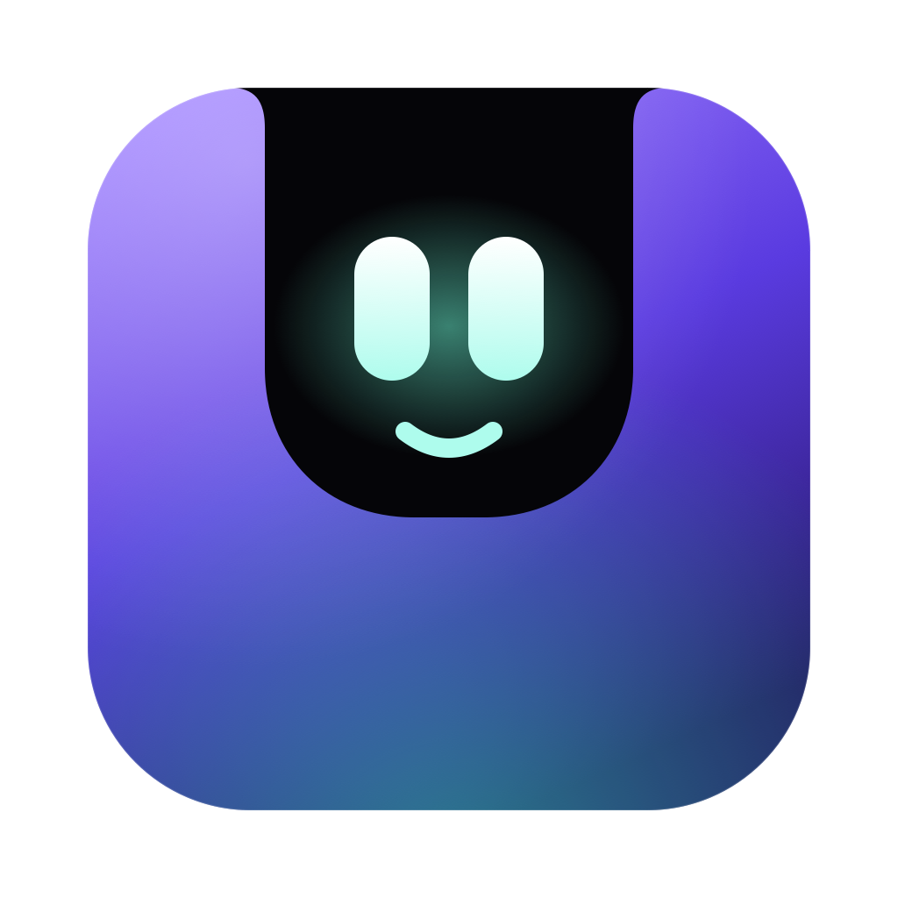

<p align="center"></p>

<h1 align="center">Notchy</h1>
<p align="center">Your Mac, with a personality. It talks to you from the notch.</p>

Notchy reacts to what your Mac is doing — charger plugged in, battery low, AirPods
connected, waking up, unlocking, drives, overheating, 2 am coding — with a line that grows
out of the camera notch, a pair of animated eyes that match the mood, and a voice.

- **Three personalities**: Desi Dost, Sassy and Dramatic, in English or Hinglish
- **Voices**: the built-in Mac voices, or ElevenLabs for a natural, expressive voice
- **Lives in the menu bar**, follows you across desktops, no Dock icon

## Install

Download the `.dmg` from [Releases](../../releases) and drag **Notchy** into Applications.
Universal: Apple Silicon and Intel, macOS 12+.

Notchy is signed ad-hoc rather than with a paid Apple Developer ID, so it isn't notarized
and macOS blocks the first launch with *"Apple could not verify Notchy is free of malware"*.
To get past it:

1. Double-click **Notchy** and dismiss the warning.
2. Open **System Settings → Privacy & Security**, scroll to **Security**.
3. Next to *"Notchy was blocked to protect your Mac"*, click **Open Anyway** and authenticate.

Only the first launch needs this. On macOS 15 (Sequoia) and later, right-click → Open no
longer works — Apple removed that bypass, so the Settings route above is the one that does.

One command does the same thing on any macOS version:

```bash
xattr -dr com.apple.quarantine /Applications/Notchy.app
```

Or build it yourself, which skips Gatekeeper entirely:

```bash
pnpm install
pnpm tauri build --target universal-apple-darwin
open src-tauri/target/universal-apple-darwin/release/bundle/dmg/*.dmg
```

## ElevenLabs voice (optional)

1. Create an API key at [elevenlabs.io](https://elevenlabs.io/app/developers/api-keys) with
   Text to Speech, Voices (read) and Models (read) access.
2. Menu bar → Notchy → **Settings… → Speech → Voice engine → ElevenLabs**, paste the key, pick a voice.

Lines are cached on disk after their first play, and each personality's fixed lines are
prepared in the background, so they play instantly. The key is stored in
`~/Library/Application Support/com.nexttin.notchy/elevenlabs.key` (readable only by you).

## Develop

```bash
pnpm tauri dev                                  # fast loop; Bluetooth events are off here
pnpm tauri build --debug --bundles app          # full app incl. Bluetooth
open src-tauri/target/debug/bundle/macos/Notchy.app
```

Bluetooth only works from a `.app` bundle: macOS kills any process that touches Bluetooth
unless the app that launched it declares `NSBluetoothAlwaysUsageDescription`, and in
`tauri dev` that's your terminal.

| | |
|---|---|
| `src-tauri/src/watcher.rs` | Polls the system 4× a second and emits `mac-event`s |
| `src-tauri/src/power.rs`, `bluetooth.rs` | IOKit battery state, IOBluetooth devices |
| `src-tauri/src/notch.rs` | The click-through overlay over the notch, following Spaces |
| `src-tauri/src/voice.rs` | In-process speech (AVSpeechSynthesizer) and sounds (NSSound) |
| `src-tauri/src/elevenlabs.rs` | ElevenLabs synthesis with an on-disk cache |
| `src/lines.ts` | Every line, per personality and language — edit freely |
| `src/face.ts` | The animated eyes and their moods |
| `src/notch.ts`, `src/settings.ts` | The island and the settings window |
| `design/` | Logo source (`logo.svg`) and the script that renders it |
